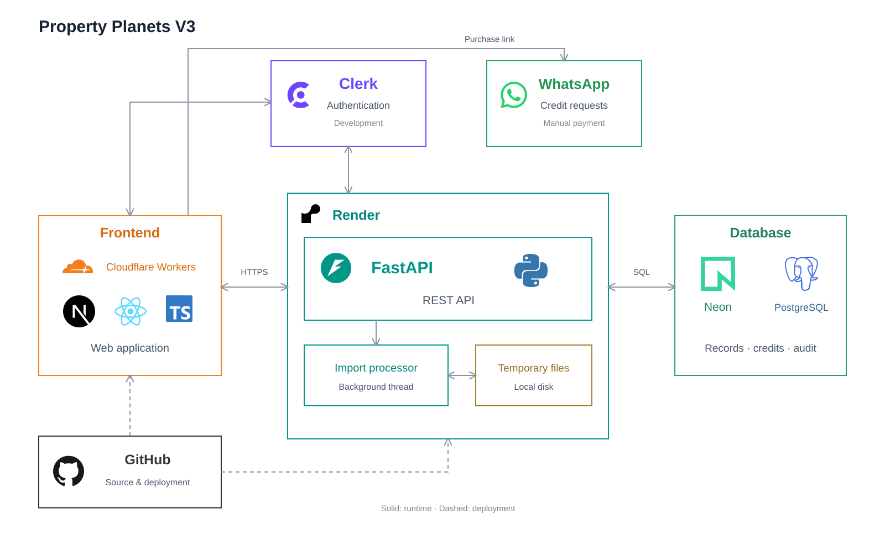

# Property Planets V3

Property directory built with Next.js, FastAPI, Neon PostgreSQL and Clerk.
Access is arranged privately; Admin assigns and adjusts user credits.

## Architecture



[PNG](docs/architecture.png) · [Editable draw.io](docs/architecture.drawio)

Solid arrows show runtime connections; dashed arrows show deployment.
The import processor runs inside the Render API. Credits are managed privately.

## Features

- Free property previews show owner names and addresses; credits unlock phone numbers, IC numbers and remarks. Free users can search names and addresses with the builder.
- One credit per new search with matches. Empty results and failures are free.
- Pagination and request retries are included. Refresh, closing the tab or signing
  out clears the active search. Admin searches are free.
- Search builder: AND/OR, five conditions per category, ten total; minimum one character per clue.
  All matching result pages are included; no record-unlock cap is implemented.
- Country-based profile phone input, stored in international format.
- Excel/CSV columns: Name, Phone 01, Phone 02, IC number, Address, Remark.
  Name and Phone 01 are required; identifiers stay as text.
- Duplicate detection, invalid-row reports and Admin audit logs.
- Search limits: 20 preview / 60 paid-search requests per account per minute.

## Project structure

| Folder / file | Purpose |
| --- | --- |
| `frontend/` | Next.js pages, components and API helpers |
| `backend/app/` | FastAPI routes, credits and imports |
| `backend/sql/schema.sql` | Fresh database schema |
| `docs/` | Architecture and deployment guide |
| `render.yaml` | Render service configuration |
| `frontend/wrangler.jsonc` | Cloudflare Worker configuration |

## Local setup

Requires **Python 3.12**, **Node.js 22**, Neon and Clerk.
Create a new virtual environment in V3 rather than copying V2's `.venv`.

**Backend terminal — from `backend/`:**

```powershell
py -3.12 -m venv .venv
.\.venv\Scripts\python.exe -m pip install -r requirements.txt
```

Create private `.env` files with these values. Frontend and backend Clerk keys
must belong to the same instance.

| Location | Variable | Value |
| --- | --- | --- |
| Backend | `DB_URL` | Neon connection string |
| Backend | `CLERK_SECRET_KEY` | Clerk secret key |
| Backend | `FRONTEND_URL` | `http://localhost:3000` |
| Backend | `IMPORT_PROCESSOR_ENABLED` | `true` |
| Frontend | `NEXT_PUBLIC_CLERK_PUBLISHABLE_KEY` | Clerk publishable key |
| Frontend | `CLERK_SECRET_KEY` | Matching Clerk secret key |
| Frontend | `NEXT_PUBLIC_API_URL` | `http://localhost:8000` |

Start the API from `backend/`:

```powershell
.\.venv\Scripts\python.exe -m uvicorn app.main:app --reload
```

**Frontend terminal — from `frontend/`:**

```powershell
npm.cmd ci
npm.cmd run dev
```

Open **http://localhost:3000**. Keep `.env` and `.venv` out of Git.

## Database

For an **empty database only**, run `backend/sql/schema.sql` once in Neon.
It creates all nine tables without seeding data. Do not rerun it for deployments.

The schema includes the six-column property format, credit adjustments and
24-hour upload expiry. No additional upgrade scripts are needed.

After creating your profile, promote the first Admin using its exact Clerk ID:

```sql
UPDATE users SET role = 'Admin', updated_at = NOW()
WHERE clerk_user_id = 'user_REPLACE_WITH_YOUR_CLERK_USER_ID';
```

Balances live in `users.credit_balance`. `credit_assignments` records Admin
additions; `credit_searches` prevents charging the same paid request twice.

## Deployment

Repo: `Patr1xk/PropertyPlanetV3`, branch `main`. Push changes before deploying.

| Setting | Render backend | Cloudflare Worker |
| --- | --- | --- |
| Name | `property-planets-v3-api` | `propertyplanetv3` |
| Root directory | `backend` | `frontend` |
| Build | `python -m pip install -r requirements.txt` | `npm run cf:build` |
| Start / deploy | `python -m uvicorn app.main:app --host 0.0.0.0 --port $PORT --workers 1` | `npm run cf:deploy` |
| Runtime | Python 3.12 | Node.js 22 for builds |

1. Deploy Render and copy its HTTPS URL.
2. Set Cloudflare's build `NEXT_PUBLIC_API_URL` to that URL, then deploy.
3. Set Render's `FRONTEND_URL` to the actual Cloudflare URL and redeploy Render.

Set environment variables on each host. Cloudflare also needs
`CLERK_SECRET_KEY` as a **runtime Worker secret**, separate from build variables.
Use the existing Clerk development instance for testing; configure production keys
and domains before the client launch.

[Full deployment steps and troubleshooting](docs/DEPLOYMENT.md)

Imports need `IMPORT_PROCESSOR_ENABLED=true`. Upload chunks on Render's local
disk can be lost on restart; a private storage bucket is supported for durability.
Completed imports delete raw files immediately. Failed/incomplete uploads expire
after 24 inactive hours on the next worker scan; re-upload afterward. History,
error reports and imported records remain. Deletion failures are retried.
Neon can be reused, but a shared database also shares V2/V3 data.

## Checks

From `backend/`:

```powershell
.\.venv\Scripts\python.exe -m unittest discover -s tests -p 'test_*.py'
```

From `frontend/`:

```powershell
npm.cmd test
npm.cmd run lint
npm.cmd run build
```

Before release, test hosted sign-in, profile, credit assignment, paid/empty searches,
pagination and a small import. See [search notes](backend/SEARCH_BUILDER.md).
